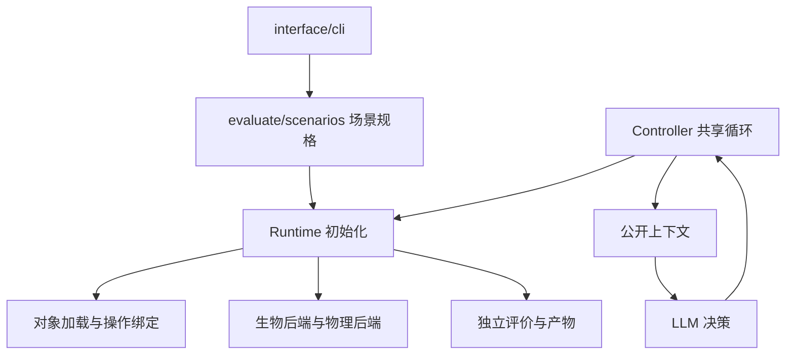

# FAIRY 代码框架审查与修改指导书

版本基线：2026-11-17，`kun`，FAIRY **0.8.2**，Runtime状态schema **7**，数值策略schema **2**。
本指导书依据当前代码路径编写，用于逐模块阅读、记录决策和安排修改；不是一次“全框架已审查通过”的结论。
历史测试与实验结果只属于其冻结版本。本次交付仅新增指导与导航，不修改运行逻辑。

本轮已补强全模块类型与核心注释，导航与静态检查方式见[类型说明](TYPING.md)。

## 1. 从这里开始

所有下述代码路径均相对于 **`experimental/`**；测试命令从仓库根执行。
根目录保留Git、`.venv`、`.runs`、`pytest.ini`；实际安装项目是`experimental/pyproject.toml`。
`reference/`及历史副本用于审计，不能作为运行时依赖。`.runs`是本机忽略产物，未随仓库发布。

建议第一次约用60–90分钟贯通主线：

1. **M01 场景**：选`soybean_l3_hn58_normal_v1`，读清初态、天气、对象与操作清单。
2. **M02/M03 契约与绑定**：追踪`irrigate_range`从声明到处理器。
3. **M04/M07 时间与后端**：追踪水何时进入引擎、谁更新作物、谁核算粮食。
4. **M08/M09 Agent**：核查模型看到了什么、谁执行请求、谁判断停止。
5. **M12/M13 评价与回放**：区分任务通过、回放一致、生长可信和策略更优。

这只是熟悉主线，不等于完成科学模型审查。随后按M05、M06、M10、M11逐项深入。
每次只审一个模块，留下“问题、证据、处理决定”；未看过的项目保持未检查。

### 统一记录方式

- 检查状态：`未检查 / 检查中 / 通过 / 需修改 / 接受限制 / 不适用`。
- 问题性质：`逻辑错误 / 架构边界 / 能力缺失 / 参数与科学依据 / 实验设计 / 文档不一致`。
- 处理优先级：`阻断正确性 / 阻断本轮目标 / 后续扩展`。
- **工程正确性**：合法输入、单位、守恒、时钟、拒绝无副作用。
- **农业有效性**：过程和参数依据、胁迫响应、校准范围、外推限制。
- **策略质量**：同场景对照、信息权限、用水与实际结果；不能由前两项直接推出。

## 2. 实际能力地图：先区分实现和目录

| 模块 | 当前已有实现 | 尚未实现或需明确的边界 |
|---|---|---|
| `acps/ontology/farm` | 农场几何、土壤参数、田间观测契约 | 单农场64垄固定全季框架，不是任意空间模型 |
| `acps/ontology/crops/lib` | 大豆参数与WOFOST品种选择 | Native HEINONG58和WOFOST Soybean_901代理不是同一校准品种 |
| `acps/ontology/equipment` | 农机/航测/地面检查操作及提供者映射 | 不包含无人机飞行动力学或拖拉机运动学 |
| `acps/ontology/infrastructure` | 土壤观测、灌溉、烘干、仓储、充电契约 | 灌溉是登记日结水深，不是泵站运行仿真 |
| `acps/ontology/service` | 当前天气与已发布预报 | 公开预报与引擎完整forcing必须分开 |
| `acps/ontology/human`、`material` | README占位 | 人员实体、独立物料批次/库存对象尚未通用实现；物料账本主要在物理后端 |
| `acps/backends/biology` | L1与全季的Native/WOFOST适配 | 生物多后端工厂已存在；全季仍有显式分支，不是通用算子分发系统 |
| `acps/backends/physical` | Native作业时长、资源消耗、容量、收储账本 | Runtime固定构建Native物理后端，尚无完整物理多引擎分发 |
| `fairy/events` | 对象/操作绑定、唯一时钟、事务、事件、状态恢复、回放 | 名称为events，实际承担运行时编排，审查时按此范围理解 |
| `agents/loop`、`models/llm` | 共享循环、公开上下文、LLM/Oracle | 真实服务故障的产品化恢复仍有缺口 |
| `agents/.../kg`、`autogen` | 生命周期卡、三值检查、局部建议服务、冻结经验 | 非HTN求解器，非完整知识图谱；建议服务记录在Agent日志中 |
| `agents/models/numeric` | 5档全田灌溉PPO训练及推理 | 不学习全部农场操作、分区选择或施肥 |
| `evaluate` | 场景、干旱组合、任务评价、数值环境、资格审查 | 任务成功不代表农业最优或田间产量预测有效 |
| `interface/cli` | run/resume/inspect/replay/evaluate及自动Oracle命令 | Web/Three.js/Jev未接入当前闭环 |

`ObjectSpec`目前主要表达身份、类型和目标引用；不是完整关系图或通用资源管理系统。
能力限制主要在`BackendCapabilities`和操作所需后端动作中表达；没有独立的通用能力图谱。
阅读时应判断这些简化是否满足当前目标，不要把未来目录含义当成现有功能。

## 3. 两条必须亲自走通的调用链

### 3.1 初始化与决策



这是运行流程图，不是严格无环的包依赖图。例如`Runtime.from_state`实际导入
`evaluate.scenarios.spec`；Controller也导入评价模块。是否接受这些依赖，应在M03/M12记录决策。

### 3.2 一次灌溉与一次收获

| 操作 | 实际路径 | 要看到的关键事实 |
|---|---|---|
| `irrigate_range` | `ontology/infrastructure/irrigation.py:IRRIGATE_RANGE` → 场景`operation_bindings` → `events/registry.py` → `Runtime.invoke` → `_season_operation` → `backend.queue_irrigation` | 按选定面积计算全田平均额度；接受时扣额度并登记pending；此时不推进时钟 |
| 日结 | `Runtime._advance_time` → `backend.advance_day` → `environment_day_completed` | 仅跨本地日界结算一次，WOFOST转换mm为cm，Native执行自己的水量过程 |
| `harvest` | `ontology/equipment/combine.py` → `Runtime.invoke` → `physical.plan` → `ScheduledJob` → 推进时钟 → `physical.execute` → `biology.harvest` | 检查成熟与容量；完成时再次检查；生物侧移出毛粮，物理侧记录回收及损失 |

建议在IDE给这些函数下断点，分别执行一次成功灌溉、超额灌溉、跨日收获拒绝。
不要仅观察终端“success”；同时看请求、事件、pending、引擎和物料账本。

## 4. 逐模块检查清单

### M00 基线、目录和依赖

**入口**：`pyproject.toml`、`fairy/__init__.py`、根`pytest.ini`、`RELOCATION.md`。

- [ ] 确认当前分支、源码指纹、版本、状态schema、模型/参数版本。
- [ ] 区分当前包与`.runs`中冻结旧包；确认解释器实际导入的位置。
- [ ] 搜索运行模块对`reference/`、历史App、`fairy/runtime`旧路径的依赖。
- [ ] Native核心与查看日志是否能在没有PCSE、Torch、OpenAI凭证时使用。

**完成物**：本次审查基线记录。改动安装布局需同时检查CLI、打包、子进程和README。

### M01 场景、normal与扰动构建

**入口**：`evaluate/scenarios/spec.py`、`season.py`、`normal.py`、`compose.py`、`disturbances.py`；
`lib/l3/{common,soybean_normal,soybean_wofost}.py`；`registry.py`。

- [ ] 一个场景究竟声明哪些对象、工具、天气、初态、预算、任务成功要求？作物/装备固有参数与任务输入是否混在SeasonSpec？
- [ ] normal是否只是便于验收的理想条件？雨3mm/日、ET0=3mm/日是否使管理决策失去区分度？
- [ ] 扰动日历是否离线冻结，候选晚播或观测不能让扰动重新排期？不同后端分期是否诚实区分？
- [ ] 同场景处理/对照是否只改变预定管理动作？场景构造函数是否避免创建引擎？

**验证**：`test_scenario_composition.py`，Native/WOFOST各自的`normal_validation.py`、`wofost_validation.py`。
**完成物**：一张场景输入表及一组同输入对照。修改天气/参数需审查参考日历、来源指纹和策略适用范围。

### M02 Ontology对象、操作与公开契约

**入口**：`acps/ontology/contracts.py`；各领域的`operations.py`、`observations.py`、`season.py`；`farm/spec.py`。

- [ ] 能区分被动对象、能力提供者、可调用操作和消耗物？当前哪些只是账本字段？
- [ ] 参数、单位、返回值、错误、只读/日结/作业时长语义是否完整一致？
- [ ] 用同一操作名调用两个生物后端时，公开含义一致，但没有承诺数值相等？
- [ ] 有没有“接口接受参数，但过程不响应”的情况？密度、播深的限制是否明确告诉使用者？

**验证**：`test_ontology.py`、`test_review_agents.py`、`test_pilot.py`。
**完成物**：对象→操作→处理者对照表；新增对象不能只增加目录或README而宣称功能完成。

### M03 注册、绑定和后端协议

**入口**：`events/registry.py`；`acps/backends/biology/contracts.py`；`physical/contracts.py`；
`events/session.py:Runtime.__init__/_make_physical`。

- [ ] 对象类型白名单、重复ID/操作、提供者目标和场景工具清单是否一致？
- [ ] L1注册表、全季工厂显式分支、固定Native物理后端的差异是否符合下一轮目标？
- [ ] 不支持的作物、品种、操作或后端是否明确拒绝？有无静默切换？
- [ ] 公共`RidgeStatus`是否足够？物理侧/评价侧是否仍读取某个生物引擎私有字典？

**验证**：`test_ontology.py`、`test_wofost_season.py`的后端/品种及策略scope测试。
**完成物**：当前真实依赖图及接入一个新后端所需改动清单；不要直接照搬完整PyTorch分发复杂度。

### M04 唯一时钟、事务与事件

**入口**：`events/session.py:invoke/_advance_time/_season_operation/_rollback`；`records.py`、`operations.py`。

- [ ] 时钟是否只由Runtime推进？只读工具是否既不推进时间也不改变物理/生物状态？
- [ ] 同日重复观测、分段推进、作业跨午夜和期限边界，是否只产生应有的日更新？
- [ ] 完成时前提变化导致拒绝，是否回滚时间、引擎、库存、pending和相关事件？
- [ ] 调度对象、请求、结果、环境变化、终止事件能否用seq/cause串联？拒绝只留下合法审计记录？

**验证**：`test_review_runtime.py`、`test_hscc_fixes.py`、`test_l3.py`。
**完成物**：成功与跨日拒绝各一条逐事件时序，列出回滚前后全部关键账本。

### M05 Native生长与水量过程——高优先级

**入口**：`acps/backends/biology/native/backend.py`（L1）与`season.py`（全季）；`SEASON_AUDIT.md`。

- [ ] 分开审查L1固定冠层水桶与全季RUE模型；不把L1验证等同全季生物学验证。
- [ ] 明写降雨/有效灌溉、蒸发、蒸腾、排水、径流及土壤储水守恒；检查计算顺序的影响。
- [ ] 从水分胁迫追到LAI、干物质、籽粒分配、成熟；哪些真实过程被省略或参数写死？
- [ ] 验证零ET0边界、密度/播深响应和干旱历史效应；不以产物可回放替代响应合理性。

**验证**：`test_l3.py`、`test_review_physics.py`和[敏感性审计](demo/GROWTH_SENSITIVITY_AUDIT.md)。
**完成物**：方程/单位/参数来源表和响应曲线；明确“修复错误”与“新增过程/校准”的区别。

### M06 WOFOST接入、单位与适用模式——高优先级

**入口**：`acps/backends/biology/wofost/backend.py`、`season.py`、`soybean.yaml`、`provenance.json`。

- [ ] 确认实际PCSE类、版本、自由排水模式、氮供应假设、IOX开关与代理品种来源。
- [ ] 核对雨/灌溉mm→cm、辐射MJ→J、kg/ha→kg、土层cm→m；不能只检查总结果。
- [ ] 审查DeferredRates时序、播种前土壤、日结灌溉、成熟清理和64独立土柱是否隔离。
- [ ] 记录有蒸腾需求时的SM、RFTRA、TRA/TRAMX、DVS、TAGP、TWSO；与原生PCSE同输入对照。

**验证**：`test_wofost_season.py`；本机`.runs/wofost_growth_audit_20261117/`有6组原生PCSE对照。
**完成物**：模式/单位清单及逐日差异报告。WLP通过不能宣称施肥响应已接入；洪涝需另审查缺氧与排水假设。

### M07 物理作业、装备与物料账本

**入口**包括 `acps/backends/physical/native/backend.py`、`ontology/equipment/operations.py` 和各实体模块。收割、烘干和入库声明分别位于 `ontology/equipment/combine.py`、`ontology/infrastructure/dryer.py` 和 `ontology/infrastructure/grain_warehouse.py`。

- [ ] 装备、传感器、设施的操作归属是否清楚？库存目前集中在物理后端是否满足需求？
- [ ] 作业时长、通行条件、燃料/电量、容量、种子消耗是否各只有一个真值来源？
- [ ] 毛粮→机械回收/损失→卸粮→干燥→仓储，干质量和水质量是否分别守恒？
- [ ] 容量错误是否可由公开回执合理避免？未知田间粮重不能从隐藏状态偷渡进Agent检查器。

**验证**：`test_review_physics.py`、`test_l3.py`；真实LLM的8次容量拒绝见[专项报告](demo/WOFOST_REAL_LLM_COMPARISON.md)。
**完成物**：粮食流转图、资源消耗表；若新增Material对象，明确旧账本如何迁移，避免重复库存。

### M08 公开观测、上下文与信息权限

**入口**：`agents/loop/context/public.py`、`history.py`；`controller/autogen/public.py`。

- [ ] 每个公开字段都能追溯到任务、公开契约、真实回执或明确发布的天气？
- [ ] 日志截断/同值行分组是否保留目标覆盖、时间、未解决错误和当前观测？预算按字符而非token是否明示？
- [ ] 同日播种、库存改变、收获部分地块后，旧证据是否正确失效，阶段是否错误倒退？
- [ ] Public容器投影是否只使用成功回执？未经观测的质量/容量是否标为未知，而非读后端补全？

**验证**：`test_hscc_fixes.py`、`test_oracle_autogen.py`、`test_wofost_season.py`公开容器与部分收获测试。
**完成物**：公开字段来源表和连续/恢复上下文对照；审查错误正文是否泄露隐藏信息。

### M09 Agent循环、LLM协议和停止/中断

**入口**：`agents/loop/controller/run.py`、`strategies.py`、`models/decision.py`、`models/llm/adapter.py`。

- [ ] 模型仅产出请求，controller执行循环，Runtime改变仿真状态；Oracle特权是否由可信策略类授予？
- [ ] 文本结束、非结构化伪工具文本、协议错误、工具拒绝、服务错误、预算耗尽是否区分？
- [ ] 步数、工具错误、协议错误及token用量是否跨续跑累计？重复读取会诊断，但不会后台代替模型等候？
- [ ] HTTP500/超时与引擎错误是否应有不同的可恢复语义？done=true产物为什么正式resume会拒绝？

**验证**：`test_review_agents.py`、`test_hscc_fixes.py`、`test_oracle_autogen.py`；真实500恢复链见专项报告。
**完成物**：错误分类/状态转换表。实验脚本重建成功操作前缀不是产品化故障恢复API，不应靠改done或删日志伪装续跑。

### M10 生命周期、前置检查、数值建议服务与经验

**入口**：`agents/loop/context/kg/lifecycle.py`及YAML/provenance；`controller/autogen/{extension,guards,memory}.py`。

- [ ] 知识是来源可核实的阶段目标，还是把人工计划/日期/剂量塞回了模型？WOFOST程序卡与真实LLM提取要分开。
- [ ] PASS/BLOCKED/NEED_OBSERVATION是否区分公开硬条件、未知量和生成协议？与物理规则重复处会不会漂移？
- [ ] `request_irrigation_advice`是Agent局部服务；为何不属于ACPS物理操作？其日志与Runtime事件能否对应？
- [ ] 一日一次数值决策、证书重签、实际灌溉、pending结算、恢复、冻结经验是否保持一致？

**验证**：`test_oracle_autogen.py`。继续核查经验来源、局部成功/整季成功、兼容profile和运行间更新。
**完成物**：一次建议→真实灌溉的绑定证据，以及一条经验从原事件到检索的完整来源链。

### M11 PPO训练环境、动作与奖励

**入口**：`agents/models/numeric/{irrigation,training}.py`；`evaluate/oracle/environment.py`。

- [ ] 明确5档全田剂量、动作掩码、8个公开特征及归一化；64垄、60mm、3500kg等常数的适用域是否明确？未观测不能当零建议。
- [ ] 固定播前/收后driver与真实LLM工作流分别记成绩；128步真实轨迹不能当成2048步模型验证。
- [ ] 训练天气是否变化且覆盖问题？奖励、gamma、训练预算、多种子及留出集是否支持结论？
- [ ] 记录建议概率、实际日期、用水和结果；额度耗尽后的被迫零动作不等于学会节水。

**验证**：`test_oracle_autogen.py`真实小规模梯度/权重完整性测试；数值对照与同水额时机探针见专项报告。
**完成物**：训练配置、学习证据、独立基线表。当前PPO未胜出；不要为使其胜出而事后改评分或覆盖旧产物。

### M12 任务评价、资格与Oracle的定义

**入口**：`evaluate/metrics/{__init__,irrigation,season}.py`；`evaluate/oracle/qualification.py`；
`agents/loop/controller/{oracle,season_oracle}.py`。

- [ ] 成功条件究竟是补水目标还是全季收储？极低但正入库量也可能通过，是否符合当前任务定义？
- [ ] 干物质、湿质量、用水、错误、回放、流程完整性分别报告？不存在隐含“产量最优”门槛？
- [ ] 脚本Oracle权限、动作粒度、信息量与LLM/PPO是否不同？没有把特权参考称作全局最优？
- [ ] 筛选是否按源码/后端/场景/目标分域，是否验证实际策略指纹，而非看文件名？

**验证**：`test_l3.py`、`test_oracle_autogen.py`、`test_wofost_season.py`资格和比较域测试。
**完成物**：成功定义、指标表、候选资格证据；指标变化需要单独版本化，不能悄悄改变历史结论。

### M13 恢复、回放、版本与产物

**入口**：`events/artifacts.py`、`provenance.py`、`session.py:export_state/from_state`；各后端`load_state`。

- [ ] 区分inspect只读JSON、恢复引擎、回放重新执行三条路径；后两者不重新调用模型。
- [ ] Native完整快照与WOFOST初始化＋输入日志重建是否分别核验，恢复成本是否明示？
- [ ] 待结算灌溉、拒绝、取消、部分收获和库存转移在新进程恢复后是否一致？
- [ ] 源码/参数/契约/场景/权重指纹是否齐全？全包源码绑定的保守失效范围是否接受？

**验证**：`test_review_runtime.py`、`test_hscc_fixes.py`、`test_wofost_season.py`及冻结轮包独立回放。
**完成物**：兼容性矩阵与新进程恢复证据。不能通过手改版本/哈希让旧产物“兼容”。

### M14 CLI、打包、文档与实验交付

**入口**：`interface/cli/{__main__,oracle}.py`；`pyproject.toml`；`demo/oracle_mvp.py`；各README。

- [ ] 两套CLI的场景/后端/预算/凭证/输出约定是否一致？已有输出是否在调用模型前拒绝覆盖？
- [ ] 轮包在仓库外能否运行？离线数据是否全打包？可选依赖是否按需导入？
- [ ] 实验脚本是否硬编码私有服务、路径或凭证？当前重要验证是否只藏在忽略的`.runs`？
- [ ] README是否区分0.7.2/0.8.0/0.8.1，是否把历史已通过数字误当当前验收？

**验证**：CLI帮助、Native无凭证运行、已有输出拒绝测试、轮包安装及独立回放。
**完成物**：可复制命令、参数来源、冻结版本与结果摘要。真实LLM试验与普通pytest分开运行。

## 5. 已知事项登记：不要当成待发现的新结论

以下来自已有代码/实验审计；具体证据见[生长敏感性审计](demo/GROWTH_SENSITIVITY_AUDIT.md)
和[WOFOST真实LLM报告](demo/WOFOST_REAL_LLM_COMPARISON.md)。这里的“确认”不表示已修复。

| ID | 已确认现状 | 审查决定应回答什么 | 模块 |
|---|---|---|---|
| K01 | Native零ET0时growth_stress置0，供水光温充分也不积累干物质 | 修正边界，还是显式限制输入域？需要独立回归 | M05 |
| K02 | Native密度/播深改变资源或契约，未进入相应生物响应 | 接入过程，或清楚限制能力与参数意义 | M02/M05 |
| K03 | WOFOST WLP使用无限氮供应；IOX=0 | 先明确能力；若接入氮/缺氧，另做参数与过程验收 | M06 |
| K04 | normal固定雨3/ET0=3，WOFOST有效生长期RFTRA=1 | 作为无胁迫对照保留；另建代表性天气/胁迫场景 | M01/M06 |
| K05 | HTTP500被处理为execution_error终止；正式resume不接受done产物 | 定义可恢复服务失败状态与累计预算，再改实现 | M09/M13 |
| K06 | 最新真实LLM有8次容量错误、10次预检查拦截，漏5个数值窗口 | 补充公开可执行提示/契约；不能在后台代替模型操作 | M07–M10 |
| K07 | 正式PPO前12天耗光60mm，弱于零灌溉；原生PCSE对照一致 | 审查训练分布、预算、时机与奖励，不先归咎于引擎失效 | M01/M11 |

**尚未作结论的架构问题**：Runtime/评测规格依赖边界、全季工厂分支、物料实体化、通用物理后端注册、
重复规则来源、运行时集中度。这些应通过M01–M14审查决定，不能在未检查前统称“架构错误”。

## 6. 修改前先查影响范围

| 要修改的内容 | 至少一起检查 | 需要重新生成/验证的证据 |
|---|---|---|
| 操作参数/返回/时序 | 场景绑定、Agent schema、guard、handler、回执投影 | 契约版本、绑定指纹、非法输入/回滚/回放 |
| 水量/生长方程或参数 | Native/WOFOST适配、参考日历、扰动暴露、任务与PPO | 过程守恒、响应对照、日历差异、策略重新训练 |
| 物理作业/收储账本 | Runtime事务、公开容器、评价、恢复 | 毛粮/损失/干燥守恒、容量拒绝、跨日回滚 |
| 公开上下文 | 内存保留、阶段判定、建议特征、知识/经验、续跑 | 信息隔离、分组预算、连续与恢复一致 |
| 服务失败/恢复状态 | loop、CLI、元数据、事件、预算、资格审查 | 无物理副作用的失败重试及新进程续跑 |
| 指标/奖励/筛选 | 训练与验证定义、比较域、历史报告 | 新目标显式版本化，旧结果原样保留 |
| 目录/模块名 | 导入、子进程字符串、打包数据、README | 搜索旧路径、无可选依赖、轮包独立运行 |

当前任何打包`.py/.json/.yaml`变化都可能改变全包源码指纹，**即使改动不在生长模块**也可能使旧策略失效。
开始长实验前冻结源码/轮包，使用隔离导入路径；不要在可变工作区启动长任务再并行修改。
参考日历只在有意改变基线且审查差异后重建；不能为了让测试通过而直接刷新。

每项修改的最小流程：

1. 写清问题、受影响行为和一个最小反例；先决定是错误、缺失能力还是接受的简化。
2. 确定唯一状态所有者与契约归属，再修改；避免增加第二套时钟、库存或水量结算。
3. 跑与改动直接相关的现有测试；对真实错误补最小回归，避免为纯重命名镜像实现造测试。
4. 按影响表补同输入对照、恢复与回放，确认后再扩展场景。
5. 更新版本/来源/文档并保留旧产物；是否提交由用户另行决定，本指导书不执行commit或push。

## 7. 可复制的检查入口

以下从仓库根执行。各输出文件名示例需选尚不存在的路径。

```bash
# 仅收集测试，先检查测试范围，不调用真实LLM。
.venv/bin/python -m pytest --collect-only -q

# 核心契约与时钟；未安装可选依赖的测试是否跳过，需查看报告。
.venv/bin/python -m pytest -q experimental/demo/test_ontology.py experimental/demo/test_review_runtime.py experimental/demo/test_hscc_fixes.py

# 生物/物理、场景与Agent分组。
.venv/bin/python -m pytest -q experimental/demo/test_l3.py experimental/demo/test_review_physics.py experimental/demo/test_scenario_composition.py
.venv/bin/python -m pytest -q experimental/demo/test_review_agents.py experimental/demo/test_oracle_autogen.py

# WOFOST可选依赖已安装时运行；模型不需要真实LLM凭证。
.venv/bin/python -m pytest -q experimental/demo/test_wofost_season.py

# 无模型凭证的最小闭环。第二条会重新执行仿真；inspect只查看原始JSON。
.venv/bin/python -m interface.cli run --scenario soybean_l1_irrigation_v1 --backend native --out .runs/review-native-l1-001.json
.venv/bin/python -m interface.cli replay .runs/review-native-l1-001.json
.venv/bin/python -m interface.cli inspect .runs/review-native-l1-001.json

# 两套CLI帮助；不发起真实服务请求。
.venv/bin/python -m interface.cli --help
.venv/bin/python -m interface.cli.oracle --help
```

若PCSE尝试向受限用户目录写日志，应使用独立的PCSE日志配置；本机此前的配置目录是
`/tmp/fairy_pcse_config`，通过`PYTHONPATH=/tmp/fairy_pcse_config:experimental`前缀启用。
该临时目录可能失效，先检查配置内容；不要改HOME或模型源码来规避日志问题。

这份指导书的验证仅覆盖路径、测试收集、命令入口和文档链接，不声称已重新跑完全量科学/真实LLM试验。
现有394项通过是冻结0.8.1的历史回归证据；本次审查结论须按实际执行重新记录。

## 8. 你的检查记录模板

每检查一个模块，复制一份：

```markdown
### M__ 模块名
- 状态：未检查 / 检查中 / 通过 / 需修改 / 接受限制 / 不适用
- 当前版本与源码指纹：
- 已阅读文件与关键函数：
- 我理解的职责、输入、输出和状态所有者：
- 架构问题：
- 行为/农业过程问题：
- 最小反例或事件/日过程证据：
- 决定：修复 / 补能力 / 修改契约与说明 / 暂缓（理由）
- 影响模块与需作废/重建的产物：
- 已执行检查与结果（含跳过）：
- 尚未覆盖的边界：
```

首轮审查总表：

| 模块 | 状态 | 主要发现/决策 | 证据位置 |
|---|---|---|---|
| M00 基线与依赖 | 未检查 | | |
| M01 场景与扰动 | 未检查 | | |
| M02 Ontology契约 | 未检查 | | |
| M03 注册与协议 | 未检查 | | |
| M04 时钟与事务 | 未检查 | | |
| M05 Native | 未检查 | | |
| M06 WOFOST | 未检查 | | |
| M07 物理与物料 | 未检查 | | |
| M08 公开上下文 | 未检查 | | |
| M09 Agent与服务故障 | 未检查 | | |
| M10 知识/检查/建议/经验 | 未检查 | | |
| M11 PPO | 未检查 | | |
| M12 评价与Oracle | 未检查 | | |
| M13 恢复与回放 | 未检查 | | |
| M14 CLI与交付 | 未检查 | | |

## 9. 辅助资料：按问题查，不必从头读完

- [生长敏感性审计](demo/GROWTH_SENSITIVITY_AUDIT.md)：WOFOST模式与原生对照、Native过程缺口。
- [WOFOST真实LLM专项报告](demo/WOFOST_REAL_LLM_COMPARISON.md)：真实收储、故障恢复、脚本对照与时机探针。
- [场景构建合同](evaluate/scenarios/CONSTRUCTION.md)：normal、扰动编译与来源。
- [运行时说明](fairy/events/README.md)：事件、唯一时钟、恢复与回放。
- [生物过程审计](fairy/acps/backends/biology/PROCESS_AUDIT.md)、[Native全季审计](fairy/acps/backends/biology/native/SEASON_AUDIT.md)。
- [自动Oracle实施说明](demo/AUTO_ORACLE_IMPLEMENTATION.md)、[0.7.2历史验收](demo/AUTO_ORACLE_VALIDATION.md)：注意版本边界。
- [HSCC失败教训](HSCC失败教训与FAIRY2.0设计准则.md)：设计约束来源，不替代当前代码事实。
